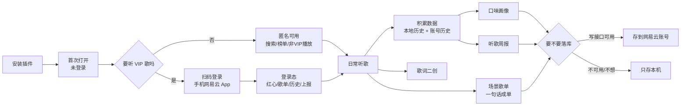
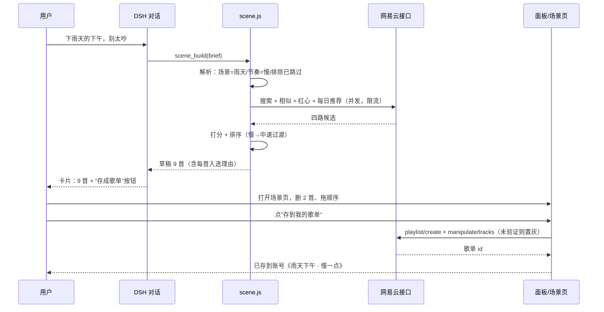
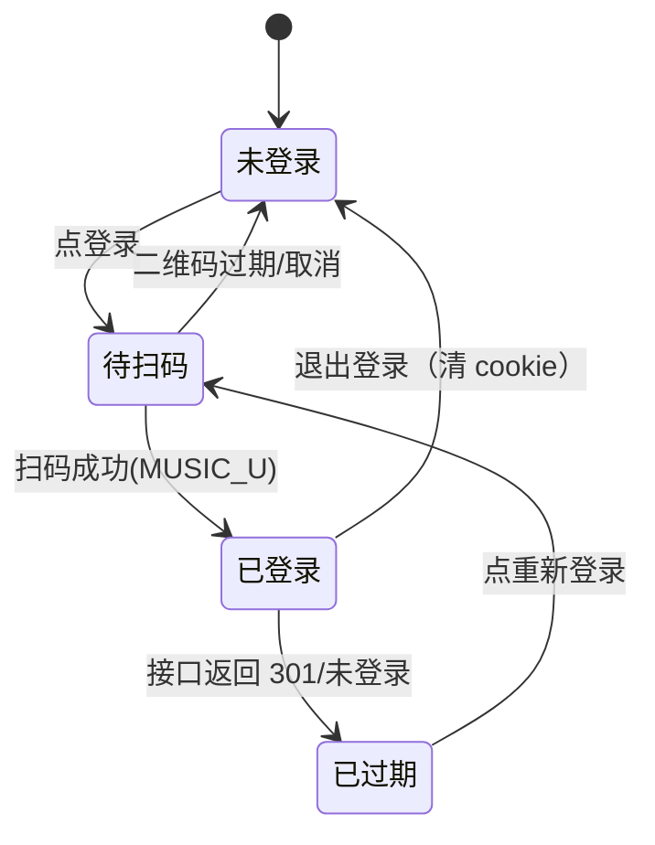

# 流程设计 · 产品流程与使用流程

> 配套 `PLAN.md`（分层与里程碑）与 `design/`（五屏概念稿）。
> 本文回答三件事：用户从装到用经过哪些阶段（产品流程）、每一步具体怎么操作（使用流程）、系统内部状态怎么流转（时序与状态机）。

---

## 1. 产品流程（生命周期）



四个阶段：

| 阶段 | 用户在意什么 | 产品必须做到 |
|---|---|---|
| **接入**（安装→首屏） | 别让我配置一堆东西 | 不登录也能用；登录入口在面板上，不在设置里 |
| **日常**（听歌） | 别断、别卡、别抢焦点 | 引擎在 shell，切会话不断音；面板只是遥控器 |
| **洞察**（画像/周报） | 说得准，且我能核对 | 每个结论可下钻到原始曲目；明示数据范围（账号 or 本机） |
| **创作**（场景/二创） | 一句话出结果，能改能存 | 草稿可增删排序；落库前明确告知会写到哪 |

---

## 2. 使用流程（五个典型剧本）

### 剧本 A · 第一次用（3 分钟）

1. 插件市场装 `ncm-plugin` → 重启 → 侧栏出现「音乐」。
2. 点开 → 未登录态：显示搜索框、榜单、"登录"按钮。
3. 搜一首非 VIP 歌 → 点歌 → 出声（验证插件能用，不必先登录）。
4. 想听 VIP → 点「登录」→ 面板出二维码 → 手机网易云扫码 → 面板变"已登录 + 昵称"。
5. 首次登录后弹一次说明卡：「你的播放会记录到网易云最近播放，可在设置里关掉」。

### 剧本 B · 每天放歌

1. 在对话里说：`来点适合写代码的，别太吵`。
2. 工具 `music_play` 走 DJ 池子 → 队列 10 首开始播；对话里返回一行摘要 + 前 3 首。
3. 想换：`下一首` / `换一批` / `这首不喜欢`（= dislike：移出队列并写 7 天黑名单，到期自动失效；DJ 续播与场景候选都排除它）。
4. 面板里能看到队列、拖进度、调音量/静音、切音质档、看歌词。
5. 切到别的会话聊 20 分钟，回来还在播，进度没断。

### 剧本 C · 场景歌单（从一句话到一张歌单）



**关键设计**：草稿是"可解释的"——每首歌后面挂入选理由（`你红心过陈粒` / `BPM 78` / `相似于《秦皇岛》`），用户能判断"为什么给我这首"。

**场景页三个动作的语义**（只写清边界，不新增模型调用）：

| 动作 | 做什么 | 不做什么 |
|---|---|---|
| `试听全部` | 草稿按当前顺序转成**临时播放队列**，从第一首放起 | 不落盘、不进历史、不进"最近播放"；关页面即散 |
| `重排` | 同一批歌按 BPM / 情绪过渡**纯代码重排**（不出 LLM 调用，秒回） | 不换歌、不改 brief、不改入选理由 |
| `换一批` | 同一 brief 重新生成草稿（等于是再调一次 `scene_build`） | 不覆盖上一批（上一批可回退）；不自动落库 |

### 剧本 D · 周五看周报

1. 对话里说 `这周我听了啥`，或点侧栏「周报」。
2. 周报页展示：时长 / 曲目数 / 新歌 / 跳过率 + 本周最爱 TOP（按播放次数取 7 行，标题不再写"前 5 首"）+ 单曲循环榜 + 一句话总结。
3. 一句话总结由模型基于结构化数据写（数据先算好，模型只负责措辞，不许编数字）。
4. 点「分享这张周报」→ 导出 1600×960 图（就用 `design/shots/weekly.png` 的版式）。
5. 每周一自动生成上周报告（本地缓存在 `session.json` 的 `reports`，不联网也能看）。

### 剧本 E · 歌词二创

1. 面板正在播《夜航西飞》→ 点「歌词」页签 → 下方「二创」。
2. 选模式：翻译 / 改写成诗 / 藏头 / 短视频文案。
3. 左侧原词（可选中几行），右侧流式出结果。
4. 不满意：`重新生成` 或 `换个风格`；满意：`存到本机笔记`（只写本机笔记文件，**永不写账号**：不动红心、不动歌单、不动"最近播放"）。
5. 说明常驻：只把歌词文本发给模型，不发送账号信息与 cookie。

---

## 3. 系统状态机

### 3.1 登录态



### 3.2 播放态（权威状态在 L2，页面只读镜像）

```
idle → loading(取链) → playing ⇄ paused
                       playing → ended → (队列有下一首 ? loading : idle)
                       playing → skipping(用户点下一首，记 skip)
                       任一 → error(取链失败) → 跳过并在面板提示
```

规则：
- `skipping` 只记一次，30 秒内算 skip（周报/画像用）。
- `error` 不弹模态，队列自动下一首，面板角落提示「这首没有音源」。
- 播放上报在 `playedMs ≥ min(30s, duration/4)` 时触发一次，只触发一次。

### 3.3 队列态

`空 → 有歌(未播放) → 正在播 → (播完自动推进 | 手动跳转) → 队列尾 → DJ 续播或停止`

DJ 开 = 队列尾自动补 10 首；DJ 关 = 播完即停。用户手动点歌时，手动曲目插到当前之后，DJ 不抢。

队列行上三个动作，语义不许混：

| 图标 | 动作 | 系统行为 | 存储 |
|---|---|---|---|
| ♡ | 红心 | 调网易云红心接口；失败回弹提示 | 账号（接口） |
| ⊘ | 不喜欢 | 移出队列 + 写 `dislikes[id] = now`；DJ 与场景候选 7 天内排除 | 本机 `session.dislikes` |
| ✕ | 移出队列 | 仅从当前队列移除，**不记 dislike、不影响推荐** | 不落盘 |

`dislikes` 7 天到期自动清除；同一首 7 天内重复点 ⊘ 只刷新时间戳，不叠记录。

---

## 4. 数据流

```
用户动作 / 定时器
   → 工具调用 或 HTTP POST
   → L2 改权威状态（state.js）
   → 写 session.json（节流 500ms）
   → 事件 emit（type, payload, 可见 key + 单调 version）
   → SSE /music/api/events
   → 页面按 version 去重后重绘
   → 同时更新窗口内其它订阅者
```

两个必须遵守的点（参考实现在这里踩过坑）：
1. **事件带单调 version**：SSE 重连后按 version 丢弃旧事件，避免乱序把进度条拽回去。
2. **页面不持权威状态**：页面只发意图（play/pause/seek），本地乐观更新后以 SSE 回推为准。

二创额外一条：`lyric_remix` 的结果**只写本机笔记**（`$DSH_HOME/music/notes/`，0600），不写账号任何字段——它不属于播放行为，不该影响红心/歌单/最近播放。

---

## 5. 异常流程

| 异常 | 用户看到 | 系统行为 |
|---|---|---|
| 未登录点 VIP 歌 | 面板提示「这首歌需要登录」+ 登录按钮 | 不改队列，不报错 |
| cookie 过期 | 顶部黄条「登录已过期，点此重新登录」 | 暂停取链，保留队列 |
| 音源缺失 | 该行灰掉 + 角落提示「无音源，已跳过」 | 自动下一首，计入 skip 但不算 dislike |
| 接口 5xx / 超时 | 面板底部「网络不稳，重试中」 | 指数退避重试 3 次，失败降级为只读本地 |
| 播放历史读不到 | 周报页顶部「本机数据 · 换设备会丢」 | 只用本地历史，明示范围 |
| 写歌单失败 | 按钮回弹 + 「保存失败：接口不可用」 | 草稿保留，可改存本地 |
| 模型未配置 | DJ 卡灰掉 + 「去设置配模型」 | DJ 不启动，手动点歌照旧 |
| 新增功能抛错 | 该卡片显示错误态 | **绝不影响播放**（A7 红线） |

---

## 6. 交互原则（写代码时的约束）

1. **切换页面不动播放条**：详情 / 歌词 / 画像摘要是同一位置的三页签（画像页签只放摘要：3 个标签 + 一句话 + 「查看完整画像 →」，完整画像只在 `/music/taste`）；画像 / 周报 / 场景 / 二创是四个独立页，从面板进入。
2. **主动作只有红**：正在播放、主按钮、选中态。其余一律中性灰，数据正向才用青。
3. **图表不要调色盘**：数据图表的类别一律用中性灰阶（`#E8EAED → #8B909A → #5A6070 → #3A3F4A` 深浅区分），只有"当前 / 选中 / 峰值 / 第一名"用红；青只留给"正向变化"（如周报的 ↓跳过率）。禁止再引入蓝/橙/紫等第二强调色。
4. **每个结论可下钻**：画像的"华语 62%"点开是曲目列表；周报的"23 次"点开是本周播放记录。
5. **数据范围永远写清**：账号历史 / 本机历史，二者不混算；对比口径写"比上一周期（前 4 周）"，不写"比上季"。
6. **不抢焦点**：新歌开始播不弹窗、不切页、不动光标。
7. **中文单语**：不做语言切换；错误文案说人话，不甩 stack trace。
8. **窄屏单列**：1100px 以下五屏一律转单列（面板队列下移到歌词下方），不出现横向滚动。
